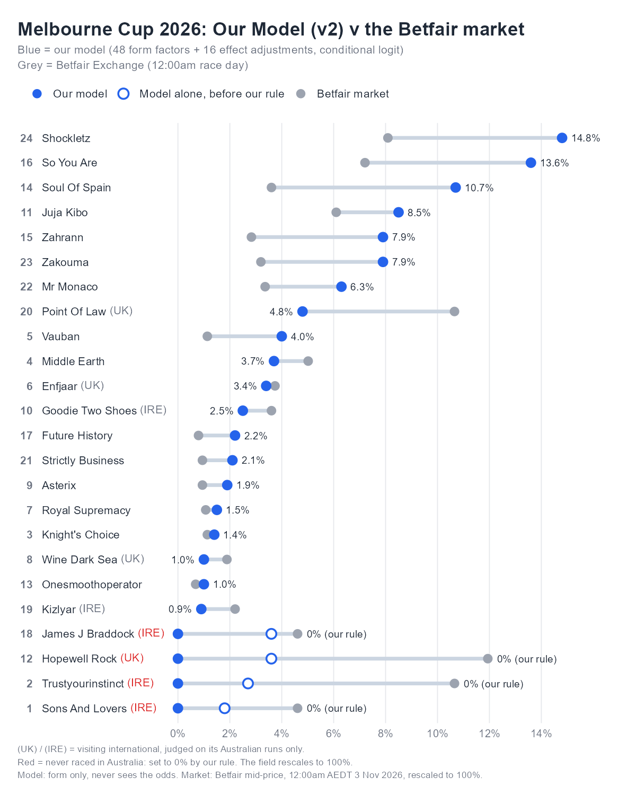

# Melbourne Cup 2026: a win-probability model in R

*By Matthew Chan & Flyn Lohan*

We built this model for the 2026 Melbourne Cup. It gives every runner in an Australian horse race a chance of winning, using form alone, and follows the approach Bill Benter made famous in Hong Kong: a **conditional logit** fitted to who actually won, then tested against the betting market on races it has never seen.

It uses **48 form factors** and **16 effect adjustments**, every one reviewed by hand by both of us, fitted on **57,000+ Australian races** (Aug 2023 – Oct 2026), plus **our own rule** for overseas horses, where the data can't see their form. This is version 2 of the model (v2).



---

## 1. The core idea

A horse race is a choice among *n* runners, and usually exactly one of them wins. (Dead heats, where two or more horses share first place, can happen but are rare.) Each horse gets a score from its form factors (speed, class, run style and so on), with each factor multiplied by a weight that says how much it matters. A horse's chance of winning is its share of the race:

$$P(i \text{ wins}) = \frac{e^{\,\text{score}_i}}{\sum_{j \in \text{race}} e^{\,\text{score}_j}} \qquad \text{(Benter, 1994)}$$

A higher score means a bigger share, and because every horse is divided by the same total, the field always adds up to 100%. In R it's two lines:

```r
race_share <- function(score, race) {   # known in statistics as the softmax function
  e <- exp(score - ave(score, race, FUN = max))
  e / ave(e, race, FUN = sum)          # each race now sums to 1
}
```

## 2. Fitting the weights

The weights are chosen so that the horses that actually won get the highest chances possible across all 57,000 races (maximum likelihood, as in Benter's paper). Two things keep the fit honest:

- **A ridge penalty.** Large weights carry a cost, so the model only leans on a factor when the evidence across thousands of races supports it (see the glossary for the exact cost).
- **Limits on every weight.** Each weight has to stay inside a range we set from racing knowledge, so noise in the data can't turn a factor upside down.

Benter's paper says to fit by maximum likelihood but doesn't say which algorithm to use. We use **L-BFGS-B**, R's standard optimiser for this kind of problem when every weight has limits (see the glossary):

```r
fit <- optim(start, neg_log_lik, gradient, method = "L-BFGS-B",
             lower = L, upper = U)    # every weight stays inside its limits
```

## 3. How the model is built

| Step | What it does |
|---|---|
| **Factors** | 48 form factors in nine groups (below), each with a written definition and the effect we expect it to have. |
| **Limits** | Every weight has to stay inside a range that makes racing sense, so no single factor can dominate or flip the wrong way. |
| **Effect adjustments** | 16 effects where the raw data gives noisy answers, because they depend on several things at once (barrier, going, weight, class, age…). We sized these ourselves from racing knowledge, and the fit only decides how much of each to use. |
| **Race tempo** | A separate model predicts how fast each race will be run, which changes how much each horse's run style matters. |
| **Fitting** | The conditional logit with the ridge penalty and limits above. The size of the penalty was picked by cross-validation (see the glossary), always keeping each race whole. |
| **Data from before the race only** | Every factor is built only from runs before race day, exactly as it would have been known at the time. |
| **Market blend** | Benter's second stage combines the model with the market's odds. We use it only to test whether the model adds anything the market doesn't already know. |

### The 48 factors, by group

| Group | What it covers |
|---|---|
| Run style & race shape | Where a horse usually settles, and how that suits the expected tempo, the field and the track |
| Sectionals | How a horse ran each part of its recent races, compared with horses of the same run style |
| Speed | Speed figures, on today's going and at today's trip, and against the rest of the field |
| Form & class | Recent finishing positions and margins, adjusted for the class of race |
| Preparation | Time since the last run, and where the horse is in its current campaign |
| Suitability | The track, the going, the distance and course-and-distance record |
| People | Jockey and trainer records, jockey changes and stable changes |
| Market history | How the market rated the horse in its recent runs |
| Stewards | Excuses and behaviour noted by the stewards at recent runs |

We also tested 17 other factors and dropped them, either because they added nothing on unseen races or because they repeated something already in the model.

### The factor review

Each factor went on a review sheet with its calculation, what it does and a worked example, and Flyn marked each one Agree / Disagree / Unsure. The result was **45 agree, 2 disagree, 1 unsure**, and each disagreement led to a change in the model. Every factor that's left has a reason a punter accepts.

## 4. Honest testing

We fitted the model on races before 1 Sep 2026, then scored it once on the **3,098 races from 1 Sep to 28 Oct 2026**. It had never seen those races.

The score is Benter's **pseudo-R²**, which measures how much better the model is than a random pick (1 ÷ field size), based on the chance it gave each actual winner:

$$\text{pseudo-}R^2 = 1 - \frac{\text{log-loss}_{\text{model}}}{\text{log-loss}_{\text{random}}} \qquad \text{(Benter, 1994)}$$

0 means no better than random, and 1 would mean always giving the winner 100%. In racing, anything above 0.1 is a real model. Both terms are explained in the glossary.

| Forecaster (same 3,098 races) | Log-loss | Pseudo-R² | Top pick won |
|---|---|---|---|
| Random (1 ÷ field size) | 2.226 | 0 | – |
| **v2, our model (form only)** | **1.962** | **0.118** | **28.3%** |
| Benter's Hong Kong model (for reference) | – | 0.125 | – |
| Betfair market, last price before the jump | 1.777 | 0.201 | 34.6% |
| Combined (v2 + market) | 1.775 | 0.203 | 34.4% |

What this tells us:

1. The model works: from form alone it scores 0.118, close to Benter's 0.125.
2. The Betfair market is better, at 0.201.
3. Combining the two only lifts the market to 0.203, so the market already prices in almost everything our model knows.

For race day we refitted the same model on all **57,261 races (543,756 runners)**.

## 5. Where the numbers stop: overseas horses

A model built on Australian form can't see a horse's overseas career. For the Cup we added two rules of our own:

- **Australian form only.** Overseas runs are left out, so an international with one or two runs here is judged on those runs alone.
- **Never raced in Australia = 0%.** These horses have a red country tag on the chart, and the rest of the field is scaled back up to 100%.

The second rule is our intuition, from what we've seen in past Melbourne Cups. A horse first up in the country:
- **a.** isn't used to Australian tracks and ground yet, and
- **b.** is still acclimatising after travelling from a very different climate.

It isn't a hard rule of racing. In the last 50 Cups (1976–2025), five winners were having their first start in Australia:

| Year | Winner | Trained in |
|---|---|---|
| 1983 | Kiwi | New Zealand |
| 1993 | Vintage Crop | Ireland |
| 2017 | Rekindling | Ireland |
| 2018 | Cross Counter | Great Britain |
| 2020 | Twilight Payment | Ireland |

The other 45 winners all had at least one run in Australia first. Our own data can't settle it either: across three years, only 134 runners were first up in Australia off overseas form, too few to call. So we show the rule openly. The hollow markers on the chart are what the model alone gave those horses.

## 6. Melbourne Cup 2026 (Flemington, 3200m, Good 4, fast tempo expected)

<!-- cup-table-start -->
| No. | Horse | Model alone | With our rule | Betfair market |
|---|---|---|---|---|
| 24 | Shockletz | 13.1% | **14.8%** | 8.1% |
| 16 | So You Are | 12.0% | **13.6%** | 7.2% |
| 14 | Soul Of Spain | 9.5% | **10.7%** | 3.6% |
| 11 | Juja Kibo | 7.5% | **8.5%** | 6.1% |
| 15 | Zahrann | 7.0% | **7.9%** | 2.8% |
| 23 | Zakouma | 6.9% | **7.9%** | 3.2% |
| 22 | Mr Monaco | 5.6% | **6.3%** | 3.4% |
| 20 | Point Of Law (UK), 1 Australian run | 4.2% | **4.8%** | 10.7% |
| 5 | Vauban | 3.5% | **4.0%** | 1.1% |
| 4 | Middle Earth | 3.3% | **3.7%** | 5.0% |
| 6 | Enfjaar (UK), 1 Australian run | 3.0% | **3.4%** | 3.7% |
| 10 | Goodie Two Shoes (IRE), 1 Australian run | 2.2% | **2.5%** | 3.6% |
| 17 | Future History | 1.9% | **2.2%** | 0.8% |
| 21 | Strictly Business | 1.9% | **2.1%** | 0.9% |
| 9 | Asterix | 1.7% | **1.9%** | 0.9% |
| 7 | Royal Supremacy | 1.3% | **1.5%** | 1.1% |
| 3 | Knight's Choice | 1.3% | **1.4%** | 1.1% |
| 8 | Wine Dark Sea (UK), 1 Australian run | 0.9% | **1.0%** | 1.9% |
| 13 | Onesmoothoperator | 0.8% | **1.0%** | 0.7% |
| 19 | Kizlyar (IRE), 1 Australian run | 0.8% | **0.9%** | 2.2% |
| 12 | Hopewell Rock (UK), never raced here | 3.6% | **0%** | 11.9% |
| 18 | James J Braddock (IRE), never raced here | 3.6% | **0%** | 4.6% |
| 2 | Trustyourinstinct (IRE), never raced here | 2.7% | **0%** | 10.7% |
| 1 | Sons And Lovers (IRE), never raced here | 1.8% | **0%** | 4.6% |

The market % is the Betfair exchange mid-price at 12:00am AEDT 3 Nov 2026, scaled to add up to 100%.
<!-- cup-table-end -->

## 7. Future improvements

| Improvement | What we'd do |
|---|---|
| **Overseas form** | Bring in international form and ratings, so visiting horses are judged on their full careers instead of our 0% rule. Then test the first-up rule properly on decades of Cup runners, not just three years. |
| **Tougher testing** | Replace the single test period with walk-forward testing: refit month by month and score each following month, so every result comes from a model that couldn't have seen it. |
| **More history** | Go back further than three years. Staying races like the Cup are rare, so the model has less to learn from at 3200m than at 1200m. |
| **More factors** | We've built a much larger set of candidate factors, including how far from the inside rail a horse raced. Each one needs the same line-by-line review as the current 48 before it goes in. |
| **Other model types** | Compare the conditional logit with machine-learning models such as gradient boosting, which can pick up interactions between factors without us specifying them. |
| **Full finishing order** | Extend from the winner to the chance of each horse placing, using the finishing-order methods in Benter's paper. |

## 8. Repository

| File | What it is |
|---|---|
| `README.md` | This write-up |
| `figures/melbourne_cup_2026.png` | The Cup chart |
| `R/conditional_logit_example.R` | A short example of the technique on made-up races. It runs in seconds with base R: `Rscript R/conditional_logit_example.R` |

## Glossary

| Term | Meaning |
|---|---|
| **Conditional logit** | The "share of the race" model in section 1. "Conditional" because each horse is only compared with the others in its own race. |
| **Ridge penalty** | The fit maximises the log-likelihood (the sum, over every race, of the log of the chance given to the winner) minus a cost of θ/2 × (w₁² + w₂² + … ), where the w's are the factor weights. The cost grows with the square of each weight, so it pulls weights towards zero unless the data clearly supports them. θ sets how strict the cost is, and we picked it by cross-validation. |
| **L-BFGS-B** | Short for *Limited-memory Broyden–Fletcher–Goldfarb–Shanno, with Bounds*, the algorithm that searches for the best weights. At each step it works out which direction improves the fit (the gradient) and estimates how the fit curves from its recent steps. It keeps only the last few steps in memory (limited-memory), and lets every weight have a lower and upper limit (bounds), which is how our limits are kept. It's built into R's `optim()`. |
| **Cross-validation** | Split the training races into 5 equal parts. Fit on parts 2–5 and score on part 1, then fit on parts 1 and 3–5 and score on part 2, and so on, until each part has been the test part once. Average the 5 scores. We did this for each possible penalty size and kept the one with the best average, without ever touching the final 3,098 test races. |
| **Log-loss** | The average of −log(chance the model gave the winner) across all races. Giving the winner 50% scores 0.69, 25% scores 1.39 and 10% scores 2.30, so lower is better, and 0 would mean always giving the winner 100%. |
| **Pseudo-R²** | 1 − (model's log-loss ÷ random's log-loss). Random gives every horse 1 ÷ field size, so its log-loss is the average of log(field size): 2.226 on our test races. Our model's 1.962 gives 1 − 1.962 ÷ 2.226 = 0.118. |
| **Mid-price** | Halfway between the best back and best lay price on the exchange. |

*Built in R with help from Claude Code for code and testing. The model, the factor design, the factor review and the racing judgement are our own.*

## Reference

Benter, W. (1994). *Computer Based Horse Race Handicapping and Wagering Systems: A Report.*

---

*For interest and education only. This is not betting advice. Our own testing says the model does not beat the Betfair market.*
